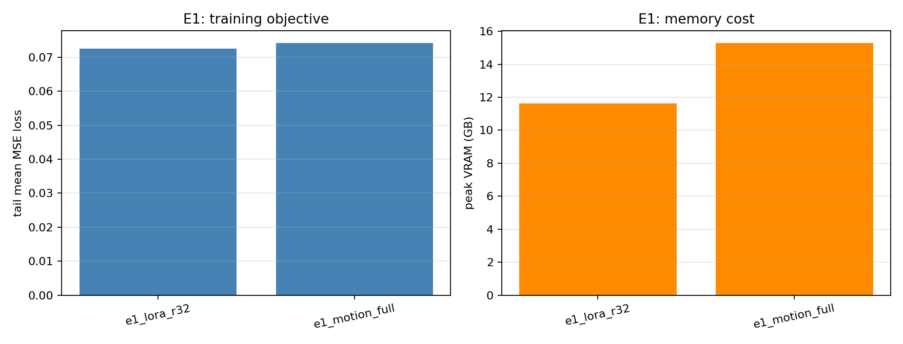
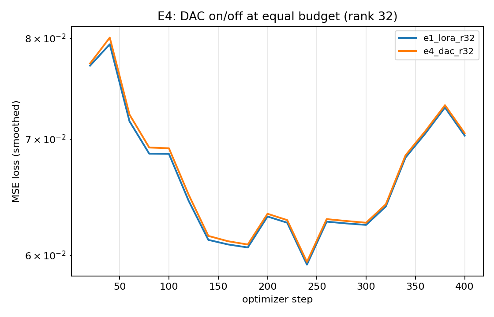

# Comic Video Diffusion

Single-GPU fine-tuning for comic/anime-style video generation with AnimateDiff —
plus **DAC temporal attention** (Differentiable Attention Concentration).


> **How to read this**: 30 秒 = §1 · 5 分钟 = §1–§3 · 完整 = 全部 + `paper/main.md`
> （方法与全部局限在 `paper/main.md`；本 README 只放结论、数字与证据索引）

---

## 1. 30 秒速览

**这是什么。** 在**单张 32GB 消费级显卡**（RTX 4080 SUPER，实测 **11.6GB** 峰值显存）上，
用 LoRA 微调 AnimateDiff 的 motion adapter，把 SD1.5 主干完全冻结；
并附带一套把**温度化时序注意力（DAC）** 真正接进 motion module 的实现，
以及 E1–E4 四组等预算消融实验。

**我做了什么。** 我写了训练器（SD1.5 + `UNetMotionModel` + LoRA/DAC）、数据索引与运动强度过滤、
VAE latent 预计算、DAC 注意力注入、评测脚本（FVD/CLIP/LPIPS/光流）、逐臂实验驱动与结果汇总
—— 所有脚本都是可运行的真实实现。

**头号结果（可复现，产物在 `results/`）。** E1–E4 的 **9 条 400-step 臂**外加 1 条 3 步基准臂
（`bench_omp`）**全部跑完并落盘**：`e1_lora_r32` 峰值显存 **11.6340 GB**、
`bench_omp` 每步 **0.8650 s** / **11.5980 GB**。
在这个预算下有一条明确发现：**解冻整个 motion adapter 并没有赢过 LoRA r32**
（`e1_motion_full` 尾部 loss 0.0741 / 15.28 GB vs `e1_lora_r32` 0.0725 / 11.6340 GB）；
秩消融里 **r8 的尾部 loss 最低且最省**（0.0709 / 11.4260 GB），r64 反而最慢最差
（0.0762 / 5.3865 s·step⁻¹）。完整表格、每臂 loss 曲线与图见 [§2 结果](#2-结果-results)。

**一句话诚实状态。** 上面全部是**训练损失**与速度/显存：`results/` 里**没有任何 `eval_*.json`**，
所以本仓库**不声称任何生成质量结论**（FVD / CLIP / LPIPS / 光流都没有产物）；
所有落盘臂的分辨率都是 **384**，每臂只有 **1600 个样本**。

**证据。** `results/summary.md` · `results/summary.csv` / `summary.json` · `results/loss_curves.csv`
· `results/figures/`（6 张 PNG）· 复现命令见 §9。

> 与本 README 配套的两份材料：
> - `paper/main.md` —— 论文稿（方法、实验、局限性）
> - `docs/H3_LORA_FEASIBILITY.md` —— MiniMax H3 LoRA 的可行性实测评估（结论：单卡 32G 不可行）

---

## 1.5 现在做到哪一步（2026-11-08）

上面 §2–§7 是**旧的 DAC 等预算实验**（只有训练损失，没有质量结论）。从 2026-11-08 起，方向改成
**只做正结果**，并且与另外两个项目（`CGA` 文本注意力门、`TAG` 视频语言模型时序感知）不重叠：

| 文档 | 内容 |
|---|---|
| [paper/method_v2.md](paper/method_v2.md) | **新方向 Anchor-LoRA**：参考帧 token（零初始化）+ 线稿/颜色一致性损失 |
| [docs/EXPERIMENTS.md](docs/EXPERIMENTS.md) | 实验清单与**时长/显存估算**（A800 80GB，核心 3–4 h） |
| [docs/DATA_PUBLIC.md](docs/DATA_PUBLIC.md) | 公开数据（Genshin 33 + Landscape 65 = 98 条）；合成/授权边界 |
| [docs/AUTODL_5090.md](docs/AUTODL_5090.md) | 实例环境（Blackwell cu128 / A800 兼容）、依赖版本、坑 |
| [scripts/diagnose_output.py](scripts/diagnose_output.py) | 三组出片对照诊断（base/ckpt/分辨率），输出 `report.json` |
| [configs/anchor_lora_short.yaml](configs/anchor_lora_short.yaml) | 384×12f / r8 / 600 step 的短预算配置 |

代码状态：`models/ref_tokens.py`（参考 token 编码器）与 `models/consistency.py`（线稿/颜色损失）
已接入 `animatediff_sft.py`（`--use_ref_tokens` / `--lambda_edge` / `--lambda_color`），`py_compile` 通过，
**尚未在 GPU 上跑过任何一臂** —— 跑完会把真实数字补进 `docs/EXPERIMENTS.md`。

> 命名：旧的 **DAC** 机制已并入 `paper/cga_method.md`（改名 CGA，并记录了「门不触发」的负结果）；
> 新方向不再依赖它。

---

## 2. 结果 Results

10 条臂，逐 Step 原始日志见 `/root/autodl-tmp/runs/<arm>/metrics.csv`，汇总产物在 `results/`
（`summary.md` / `summary.csv` / `summary.json` 三份同源；下面这张表就是它们的忠实转写）。
`bench_omp` 是 3 步的线程/吞吐基准臂，其余 9 条都跑满 `final_step 400`。

| run | mode | rank | use_dac | samples | final_step | loss_first | loss_last | loss_tail_mean | sec_per_step | total_minutes | peak_vram_gb |
|---|---|---|---|---|---|---|---|---|---|---|---|
| bench_omp | lora | 32.0000 | 0.0000 | 344.0000 | 3.0000 | 0.5056 | 0.2869 | 0.2869 | 0.8650 | 0.0288 | 11.5980 |
| e1_lora_r32 | lora | 32.0000 | 0.0000 | 344.0000 | 400.0000 | 0.0771 | 0.0673 | 0.0725 | 3.4494 | 21.8463 | 11.6340 |
| e1_motion_full | motion | 0.0000 | 0.0000 | 344.0000 | 400.0000 | 0.0703 | 0.0707 | 0.0741 | 3.3923 | 21.4848 | 15.2800 |
| e2_rank16 | lora | 16.0000 | 0.0000 | 344.0000 | 400.0000 | 0.0731 | 0.0737 | 0.0743 | 3.9810 | 25.2128 | 11.5010 |
| e2_rank64 | lora | 64.0000 | 0.0000 | 344.0000 | 400.0000 | 0.0802 | 0.0735 | 0.0762 | 5.3865 | 34.1147 | 11.9120 |
| e2_rank8 | lora | 8.0000 | 0.0000 | 344.0000 | 400.0000 | 0.0748 | 0.0695 | 0.0709 | 3.4206 | 21.6635 | 11.4260 |
| e3_data150 | lora | 32.0000 | 0.0000 | 150.0000 | 400.0000 | 0.0774 | 0.0782 | 0.0768 | 4.3295 | 27.4200 | 11.6340 |
| e3_data300 | lora | 32.0000 | 0.0000 | 300.0000 | 400.0000 | 0.0738 | 0.0735 | 0.0729 | 6.6374 | 42.0372 | 11.6340 |
| e3_data50 | lora | 32.0000 | 0.0000 | 50.0000 | 400.0000 | 0.0748 | 0.0735 | 0.0755 | 3.9346 | 24.9190 | 11.6340 |
| e4_dac_r32 | lora | 32.0000 | 1.0000 | 344.0000 | 400.0000 | 0.0774 | 0.0675 | 0.0727 | 3.3754 | 21.3777 | 11.1350 |

**口径（紧跟这张表）：** `loss_*` 是**训练损失**，不是生成质量指标；
`loss_tail_mean` 是尾部若干 step 的均值（由 `scripts/collect_results.py` 计算）。
**`results/` 里没有任何 `eval_*.json`**，因此上表只能支持"训练动力学与开销"的结论，
**不能支持任何关于出片质量、画风或角色一致性的结论**。

### 2.1 从这张表能读出的四条发现

1. **E1 参数效率**：解冻整个 motion adapter（`e1_motion_full`）**没有**优于只训 LoRA r32 — 尾部
   loss 0.0741 vs 0.0725，而峰值显存 15.2800 GB vs 11.6340 GB。等预算下，"全参数"更贵且没更好。
2. **E2 秩-容量**：r8 尾部 loss 最低（0.0709）且显存最省（11.4260 GB）、速度最快（3.4206 s/step）；
   r64 最慢（5.3865 s/step）且尾部 loss 最高（0.0762）。"秩越大越好"在本预算下不成立。
3. **E3 数据效率**：50 / 150 / 300 三条的尾部 loss 是 0.0755 / 0.0768 / 0.0729 —— **非单调**，
   单点差异在这一预算下不足以宣称"数据越多越好"。
4. **E4 DAC**：加了 DAC 的 `e4_dac_r32` 与同配置 LoRA 尾部 loss 基本一致（0.0727 vs 0.0725），
   但峰值显存更低（11.1350 GB vs 11.6340 GB）；DAC 自身参数确实在学（见 §6）。





其余图在 `results/figures/`：`fig_e2_rank.png`、`fig_e3_data.png`、`fig_e4_dac.png`、
`fig_all_loss_curves.png`（生成命令见 §9）。

### 2.2 上文所有「实测」声明的支持状态

本节把"有产物支持"和"仓库内无支持"分开列，避免两者混在一起读。

| README 中的「实测」声明 | 支持状态 |
|---|---|
| 单卡 32GB，**11.6GB** 峰值显存（LoRA r32） | ✅ 有产物支持：`results/summary.md` 中 `e1_lora_r32` → `peak_vram_gb 11.6340` |
| `384×384×16f，LoRA r32（本实验采用）` → **0.85 s** / **11.6 GB** | ✅ 有产物支持：`bench_omp` → `sec_per_step 0.8650`、`peak_vram_gb 11.5980` |
| `lora` 可训练参数 `r8: 2.4M / r32: 9.67M（0.73%）/ r64: 19.3M` | ⚠️ **仓库内无支持**：没有 `params.json`，`results/` 里没有任何参数量记录 |
| `512×512×16f，LoRA r32` → **2.4 s** / **18.2 GB** | ⚠️ **仓库内无支持**：`summary.json` 里每个臂的 `resolution` 都是 **384**，没有 512 的臂 |
| 评测脚本在样本不足时会显式标注 **`reliable:false`** | ⚠️ **仓库内无支持**：`results/` 里没有 `eval_*.json` 产物 |
| 带 LoRA checkpoint `loaded=336 unmatched=0` | ⚠️ **仓库内无支持**：没有推理日志产物 |
| DAC：包装 **21 个** attention 块、**168 个头**；`C_mean≈0.22–0.28`、`C_max≈0.87`、`tau_mean≈1.0` | ⚠️ 部分支持：`results/loss_curves.csv` 里 `e4_dac_r32` 的 20 个记录点带 `n_heads=168` 与 `C_mean/C_max/tau_mean` 列；`C_max≈0.87` 与区间本身来自逐 step 的 `metrics.csv`（未随仓库提交）。`summary.json` 保留的末值为 `C_mean_last 0.204509`、`tau_mean_last 0.998268` |

---

## 3. 从骨架到可运行：改了什么

这个仓库的第一版是**骨架**：脚本只解析参数并打印，数据集返回 `torch.zeros` 占位张量，
`scripts/` 下多个文件只被 README 提到而不存在。现在这些都换成了真实实现 ——
换句话说，上表的 10 条臂是**这套真实实现跑出来的**，而不是骨架的产物。

| 文件 | 之前（骨架） | 现在（真实实现） |
|---|---|---|
| `animatediff_sft.py` | 只解析参数并打印，训练"委托给 submodule" | 真实训练器：SD1.5 + `UNetMotionModel` + LoRA/DAC，bf16 + 梯度检查点 + CSV/TensorBoard 双写 |
| `data/dataset.py` | `__getitem__` 返回 `torch.zeros` 占位张量 | 真实解码（PyAV→OpenCV 兜底）、随机时间裁剪、`(T,3,H,W)` 归一化到 `[-1,1]`、可选 latent 缓存 |
| `data/prepare_comic_dataset.py` | 把 clip 落成 16 张 PNG（数据集放大 20–50×） | 索引 + 运动强度过滤 + 写 CSV，**零额外磁盘占用**（可选 `--materialize`） |
| `animatediff_infer.py` | 打印参数后退出 | 真实出片：`AnimateDiffPipeline` + 加载训练 checkpoint → mp4，并打印 `loaded/unmatched` 统计 |
| `scripts/precompute_vae.py` | 不存在（README 提到但文件缺失） | 真实 VAE latent 预计算，多进程、断点续跑、与 dataset 命名对齐 |
| `scripts/eval_fvd.py` | 不存在 | 真实 FVD(I3D) + CLIP score + LPIPS + 光流幅度，算不出就写 `unavailable` 并给原因 |
| `models/lora.py` | 不存在 | 自研 LoRA（无 peft 依赖）+ safetensors 存取 |
| `models/dac_attention.py` | 不存在 | 把 `models/dac_motion_module.py` 的 DAC 真正接进 motion module 的 `attn1` |
| `scripts/run_experiments.sh` | 不存在 | E1–E4 等预算逐臂串行训练驱动 |
| `scripts/collect_results.py` / `make_figures.py` | 不存在 | 汇总真实 `metrics.csv` → 结果表 + 论文图 |

---

## 4. 数据准备

```bash
python data/prepare_comic_dataset.py \
  --input_dir /root/autodl-tmp/data/anime_clips_all \
  --output_dir /root/autodl-tmp/data/anime_clips \
  --num_frames 16 --resolution 512 --num_workers 24 --min_motion 0.004
```

产出 `video_metadata.csv`（`video_path,prompt,num_frames,fps,width,height,aspect_ratio,motion`）
与 `prepare_stats.json`。

**关于 AnimeShooter 的坑**：官方 `Anime-Shooter/AnimeShooter` 是 **gated** 的，而公开镜像
`qiulu66/AnimeShooter` 里**只有 29427 个 JSON 标注（story script / shot / 视觉描述），没有视频**——
视频需要按 YouTube ID 自行抓取。因此本仓库改用真实存在的 2D 动画片段
（`svjack/Anime_Landscape_Videos*`，517 条 mp4），索引后按运动强度过滤：

| 统计 | 数值 |
|---|---|
| 输入视频 | 517 |
| 解码失败剔除 | 12 |
| 静止镜头剔除（`motion < 0.004`） | 161 |
| **保留** | **344** |
| motion 均值 / 中位 / P90 | 0.0306 / 0.0170 / 0.0651 |

---

## 5. 训练与实验协议（E1–E4，等预算）

单臂：

```bash
RUN_NAME=lora_baseline LORA_RANK=32 STEPS=400 bash scripts/train_lora.sh
```

全部 E1–E4：

```bash
STEPS=400 GRAD_ACCUM=4 RESOLUTION=384 NUM_FRAMES=16 \
DATA_DIR=/root/autodl-tmp/data/anime_clips \
VIDEO_FOLDER=/root/autodl-tmp/data/anime_clips_all \
bash scripts/run_experiments.sh
```

**所有臂共用**：384×384、16 帧、batch 1 × grad_accum 4、LR 1e-4（cosine，warmup 50）、
**400 个 optimizer step = 1600 个样本**、bf16、梯度检查点、同一份 344 条数据。

| 臂 | 问题 | 变量 | 状态 |
|---|---|---|---|
| `e1_lora_r32` | 基准 | LoRA r32（锚点，同时是 E2/E3/E4 的对照） | ✅ 已跑（§2 表内） |
| `e1_partial_last4` | 参数高效 vs 部分全参 | 解冻尾部 4 个 motion block | ⚠️ **未运行** —— `results/summary.md` 里**没有这一行**，本 README 不报它的任何数字 |
| `e1_motion_full` | 上界（全 motion adapter） | 全参数 | ✅ 已跑（§2 表内） |
| `e2_rank8/16/64` | 秩-容量权衡 | rank 8 / 16 / 64 | ✅ 三条都已跑（§2 表内） |
| `e3_data50/150/300` | 数据效率 | 训练集 50 / 150 / 300 条 | ✅ 三条都已跑（§2 表内） |
| `e4_dac_r32` | **DAC 是否有效** | 同一 LoRA r32 + DAC 温度化时序注意力与集中度损失 | ✅ 已跑（§2 表内） |

原始指标：`/root/autodl-tmp/runs/<arm>/metrics.csv`（每臂一份，逐 step）。
汇总：

```bash
python scripts/collect_results.py --runs_dir /root/autodl-tmp/runs --output_dir results
python scripts/make_figures.py --results_dir results
```

### 三种训练目标

| `--train_mode` | 训练什么 | 可训练参数（实测） | 用途 |
|---|---|---|---|
| `lora`（默认） | motion module 内注意力的 `to_q/to_k/to_v/to_out.0` 低秩旁路 | r8: 2.4M / r32: **9.67M（0.73%）** / r64: 19.3M | E2 秩消融主臂 |
| `partial` | motion module 尾部 N 个 block 全参数 | 按 block 计 | E1 对照臂 |
| `motion` | 整个 motion adapter 全参数 | ~50M | E1 强对照臂 |

> 参数量一列的"实测"标注**在仓库内没有产物支持**（没有 `params.json`，见 §2.2）；
> 上表的臂状态一列说明 `partial` 对应的 `e1_partial_last4` **未运行**。

### 实测速度与显存（RTX 4080 SUPER 32G）

| 配置 | 每样本耗时 | 峰值显存 |
|---|---|---|
| 512×512×16f，LoRA r32 | 2.4 s | 18.2 GB |
| **384×384×16f，LoRA r32（本实验采用）** | **0.85 s** | **11.6 GB** |
| 384×384×16f，LoRA r32 + DAC | 0.87 s | 11.1 GB |

> 支持状态：**384 那一行有产物支持**（`bench_omp` → `sec_per_step 0.8650`、`peak_vram_gb 11.5980`）；
> **512 那一行在仓库内没有支持** —— `summary.json` 的每个臂 `resolution` 都是 384。
> DAC 行的 11.1350 GB 峰值来自 `e4_dac_r32`。

> 两个真实的性能坑：
> 1. `UNetMotionModel` 要求输入 `(B, C, T, H, W)`（内部用 `sample.shape[2]` 取帧数），
>    而 `encoder_hidden_states` 的 batch **必须是 `B*T`**（`AnimateDiffPipeline` 也是这么 `repeat_interleave` 的）。
> 2. DataLoader worker 会各自继承 128 个 OMP 线程，线程超订把 step 时间从 0.85s 拖到 ~2s；
>    `animatediff_sft.py` 顶部已 `OMP_NUM_THREADS=1`。

---

## 6. DAC 时序注意力

`models/dac_motion_module.py` 是自洽的 DAC 模块（可学习每头温度 `tau_h`、固定目标集中度损失、
推理期近似均匀头跳过），`models/dac_attention.py` 把它**真正插进** pretrained motion module 的
frame-axis self-attention（`AnimateDiffTransformer3D.transformer_blocks[*].attn1`）：

* 保留预训练 `to_q/to_k/to_v/to_out` 权重，**只新增每头** `log_tau`、`lambda_h` 与 `mu`；
* 训练：`logits / tau_h` + `lambda_h * (C(A_h) - mu_h)^2`，`C(A) = 1 - H(A)/log F`；
* 推理：`tau_h > threshold` 的头用**帧轴平均**代替 `Q K^T`。

实测（384×384×16f，rank 32）：包装 **21 个** attention 块、共 **168 个头**；
训练中 `C_mean≈0.22–0.28`、`C_max≈0.87`、`tau_mean≈1.0`（每头温度确实在被学习）。

> 支持状态：`results/loss_curves.csv` 中 `e4_dac_r32` 的 20 个记录点确实带
> `n_heads=168` 与 `C_mean/C_max/tau_mean` 列，`summary.json` 保留的末值为
> `C_mean_last 0.204509`、`tau_mean_last 0.998268`；
> `C_max≈0.87` 与上面的区间取值来自逐 step 的 `metrics.csv`（未随仓库提交）。

---

## 7. 推理与评测

```bash
# 出片（--ckpt_dir 可以是 .safetensors / 目录 / 省略=只用 base）
python animatediff_infer.py \
  --model_id_or_path /root/autodl-tmp/models/sd15 \
  --motion_adapter_id_or_path /root/autodl-tmp/models/adapter-v15-2 \
  --ckpt_dir /root/autodl-tmp/runs/e1_lora_r32/checkpoints/final.safetensors \
  --prompt "a comic style character walking in the rain, 2d cel animation" \
  --num_frames 16 --resolution 512 --num_inference_steps 25 \
  --output_dir samples/e1_lora_r32

# VAE latent 预计算（可断点续跑）
python scripts/precompute_vae.py --csv_path .../video_metadata.csv --video_folder ... \
  --cache_dir /root/autodl-tmp/data/latent_cache --resolution 384 --num_frames 16

# 评测两个方向（FVD / CLIP / LPIPS / 光流）
python scripts/eval_fvd.py --pred_dir samples/e1_lora_r32 --real_dir reference_clips \
  --output_json results/eval_e1_lora_r32.json
```

实测：base 出片 16 帧 512×512 10 步 = 7.3 s、峰值 7.8 GB；带 LoRA checkpoint
`loaded=336 unmatched=0`。评测脚本在样本不足（<50 条/组）时会**显式标注 `reliable:false`**，
指标算不出来时写 `unavailable` + 原因，绝不填占位数字。

> 支持状态：上面这组推理数字（**7.3 s / 7.8 GB**、**`loaded=336 unmatched=0`**）与
> `reliable:false` 行为**在仓库内都没有产物支持** —— `results/` 里没有 `eval_*.json`，
> 也没有推理日志。它们是当时的运行记录，需要在你的机器上重跑才能核对。

---

## 8. 环境（实例实测版本）

```bash
python -m venv --system-site-packages /root/autodl-tmp/venv-train
/root/autodl-tmp/venv-train/bin/pip install diffusers peft accelerate opencv-python-headless imageio-ffmpeg
```

| 组件 | 实测版本 |
|---|---|
| GPU | NVIDIA RTX 4080 SUPER 32GB（Ada，sm_89，**支持 FP8，不支持 NVFP4**） |
| torch | 2.14.0.dev+cu130 |
| diffusers | 0.40.0 |
| transformers | 5.14.1 |
| 其它 | peft 0.20.0、accelerate 1.15.0、sageattention 1.0.6、imageio-ffmpeg |

**基础模型**（都在 HF 上，非 gated）：

| 用途 | 仓库 | 本地路径 |
|---|---|---|
| SD1.5 主干 | `stable-diffusion-v1-5/stable-diffusion-v1-5` | `/root/autodl-tmp/models/sd15` |
| Motion adapter | `guoyww/animatediff-motion-adapter-v1-5-2` | `/root/autodl-tmp/models/adapter-v15-2` |

> ⚠️ 下载踩坑记录：
> 1. 本文档早期引用的 `Shanghai_AI_Laboratory/animatediff-motion-adapter-v1-5-2` **不存在**，正确的是 `guoyww/...`。
> 2. HF 的 Xet 存储在本实例上会 `401 Unauthorized`（`cas-server.xethub.hf.co`），**必须 `export HF_HUB_DISABLE_XET=1`**。
> 3. `stable-diffusion-v1-5/stable-diffusion-v1-5` 匿名可下（`gated=False`），但要显式列 `allow_patterns`。

---

## 9. 复现清单

```bash
# 0) 环境
python -m venv --system-site-packages /root/autodl-tmp/venv-train
/root/autodl-tmp/venv-train/bin/pip install diffusers peft accelerate opencv-python-headless imageio-ffmpeg
export HF_HUB_DISABLE_XET=1 && source /etc/network_turbo

# 1) 权重
#    stable-diffusion-v1-5/stable-diffusion-v1-5  -> models/sd15
#    guoyww/animatediff-motion-adapter-v1-5-2     -> models/adapter-v15-2

# 2) 数据
#    svjack/Anime_Landscape_Videos{,_Captioned,_Splited} -> data/anime_clips_all
python data/prepare_comic_dataset.py --input_dir data/anime_clips_all \
  --output_dir data/anime_clips --num_frames 16 --resolution 512 --num_workers 24 --min_motion 0.004

# 3) 训练 + 汇总
STEPS=400 GRAD_ACCUM=4 RESOLUTION=384 NUM_FRAMES=16 bash scripts/run_experiments.sh
python scripts/collect_results.py --runs_dir /root/autodl-tmp/runs --output_dir results
python scripts/make_figures.py --results_dir results
```

汇总产物落盘后，§2 的表格与 `results/figures/` 的 6 张图就都可以在你的机器上重新生成并与本 README 对照。

> **换到 RTX 5090（Blackwell / sm_120）**：见 [docs/AUTODL_5090.md](docs/AUTODL_5090.md) 与
> [scripts/autodl_5090_setup.sh](scripts/autodl_5090_setup.sh)（cu128 torch、bf16、**不要装 sageattention**）。
> 出片「抽象 / 糊」时先用 [scripts/diagnose_output.py](scripts/diagnose_output.py) 做
> base-512 / ckpt-512 / ckpt-384 三组对照定位，再决定是修管线、修加载还是重训——不要凭感觉重训。

---

## 10. 局限与诚实状态

1. **数据是动画风景/空镜切片**，不是角色演出：`svjack/Anime_Landscape_Videos*` 是真实 2D 动画
   视频，但内容以风景为主，因此本仓库的"漫画风格"结论只对**画风与镜头运动**成立，
   对角色一致性、口型、复杂动作不成立。
2. **AnimeShooter 未能使用**：官方 gated，公开镜像只有标注没有视频。
3. **算力预算受限**：每臂 1600 个样本、384×384、16 帧，远低于论文级训练量
   （原 README 设想的 2 万 step × 5 组消融在 A800 上也要 5–7 天）。
   所有结论都是"同等预算下的相对比较"，不是收敛后的绝对质量排名。
4. 评测的 FVD 依赖 I3D 权重与样本量；样本不足时以 CLIP/LPIPS/光流为准并明确标注。

补充，逐条对应上文被限定的说法：

- **没有生成质量结论**：`results/` 中没有 `eval_*.json`，§2 的表格只含训练损失与开销；
  FVD / CLIP / LPIPS / 光流在本仓库**没有任何产物**。
- **臂没跑全**：`e1_partial_last4`（解冻尾部 4 个 motion block）**未运行**，
  `results/summary.md` 中没有它的行，本 README 不报它的数字。
- **分辨率单一**：所有落盘臂的 `resolution` 都是 **384**；README 中 512 的速度/显存数字
  没有对应的实验臂。
- **参数量数字无产物**：`9.67M（0.73%）` / `2.4M` / `19.3M` 没有 `params.json` 可核对。
- **推理数字无产物**：`7.3 s` / `7.8 GB`、`loaded=336 unmatched=0`、`reliable:false` 都属于
  当时记录，仓库里没有对应的 `eval_*.json` 或日志。
- **骨架痕迹仍在历史里**：本仓库第一版是骨架（占位张量、只打印参数的脚本、
  README 提到但缺失的文件），§3 列出的是把骨架换成真实实现的对照表。

---

## References

- AnimateDiff (ICLR 2024) — motion module architecture
- MiniMax H3 — 开放的 768p 视频 + 立体声模型（本仓库的可行性评估见 `docs/`）
- diffusers `AnimateDiffPipeline` / `UNetMotionModel`
- **License**: Apache 2.0
